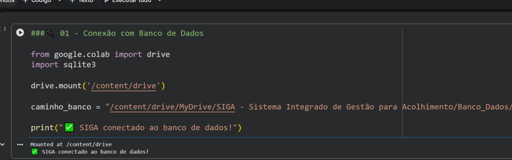
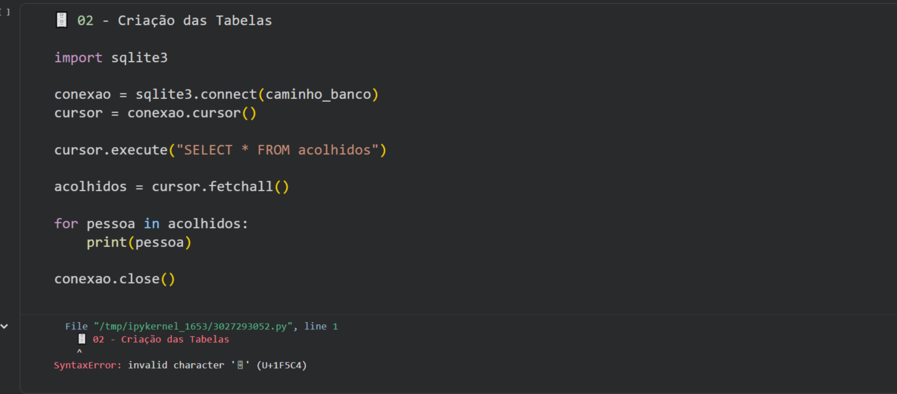
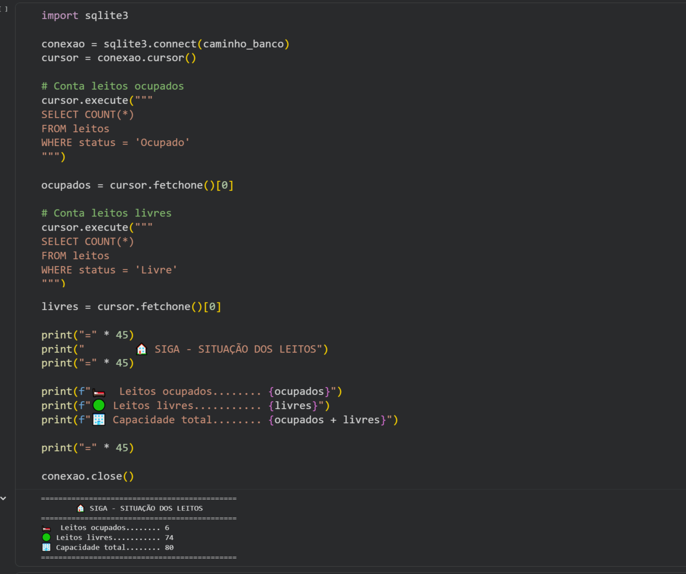
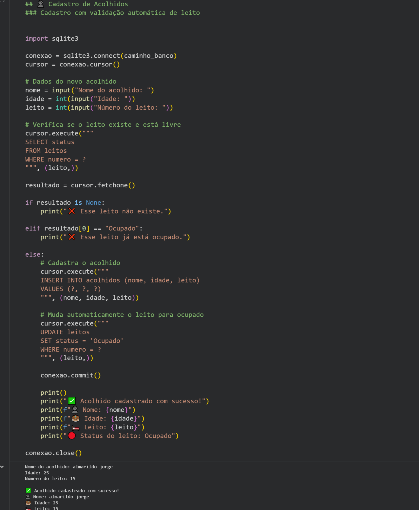
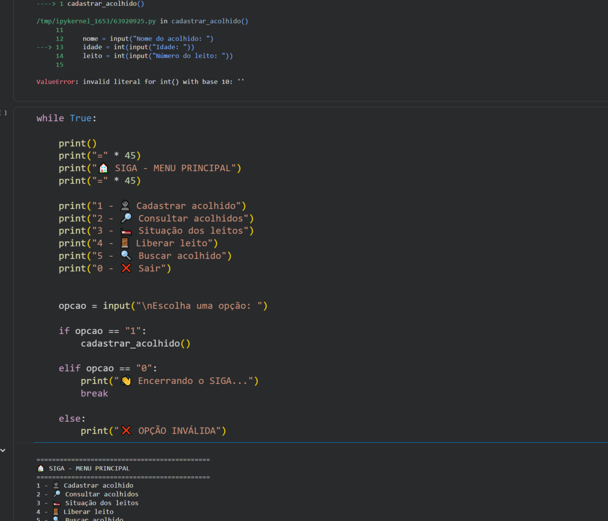
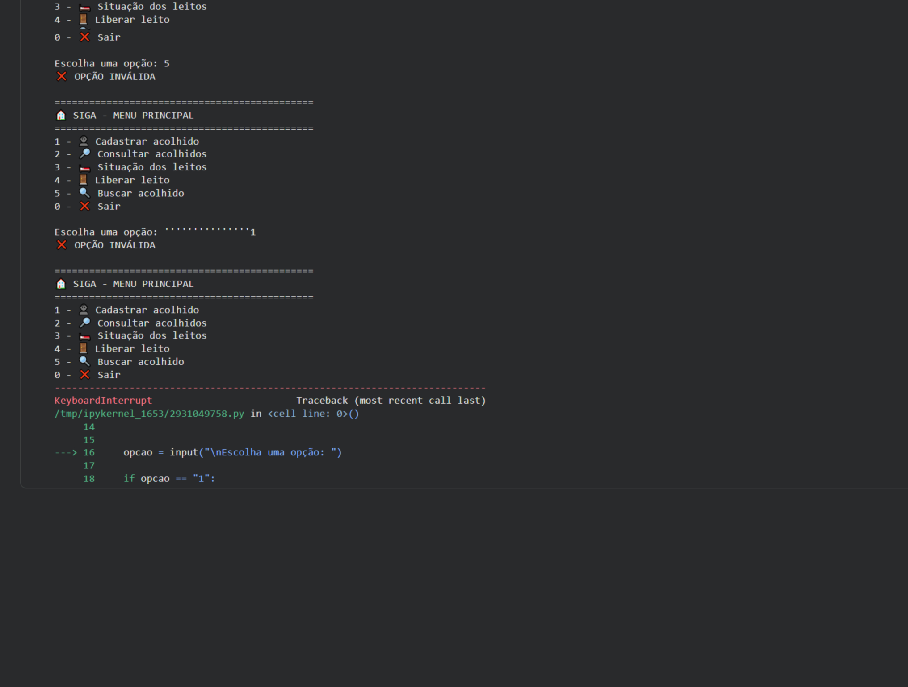

# 🏠 SIGA 1.0 — Sistema Integrado de Gestão para Acolhimento

   

## 📌 Motivação

O **SIGA** é um projeto autoral que une experiência em gestão de serviços de acolhimento com estudos em **Python, SQLite e SQL**. A proposta é explorar como informações administrativas e de ocupação podem ser organizadas em um sistema de apoio à gestão.

**SIGA 1.0 é um protótipo educacional**, não uma ferramenta pronta para uso operacional ou armazenamento de dados pessoais reais.

## ✅ O que já exploramos no Google Colab

O registro da primeira etapa apresenta funcionalidades experimentais de:

- Criação de tabela e consultas em banco **SQLite**;
- Cadastro e consulta de acolhidos;
- Busca de registros;
- Exibição da situação e disponibilidade dos leitos;
- Liberação de leitos;
- Navegação por menu no console e validação de opções.

### Código publicado

- [`src/siga_demo.py`](src/siga_demo.py) — **reimplementação demonstrativa**, usando dados fictícios;
- [`.gitignore`](.gitignore) — evita versionar arquivos locais do banco;
- [Origem das evidências](docs/ORIGEM_DAS_EVIDENCIAS.md).

> **Transparência técnica:** o notebook Python original do Colab ainda não foi recuperado como arquivo editável. O arquivo `siga_demo.py` é uma demonstração baseada nas funcionalidades registradas em capturas, **não uma cópia literal do código original**.

## ▶️ Como executar

Requer Python 3 (a biblioteca `sqlite3` já vem com Python):

```bash
python src/siga_demo.py
```

Será criado um arquivo `src/siga_demo.db` local, ignorado pelo Git. Insira **somente dados fictícios** para testar.

## 📸 Evidências da primeira versão

Os **11 prints já estão publicados** na pasta [`imagens/`](imagens/). São capturas do desenvolvimento no **Google Colab**, mostrando partes do código e as saídas da primeira versão. Abaixo estão as evidências mais relevantes para leitura do portfólio.

### 1. Conexão e estrutura do banco de dados

Trechos de conexão com SQLite e definição das estruturas utilizadas para registrar informações.





### 2. Situação e ocupação de leitos

Rotinas de cálculo e apresentação da disponibilidade de leitos, exemplificando a transformação dos registros em informações operacionais.



### 3. Cadastro e validação

Rotinas de cadastro e verificação de disponibilidade, com tratamento de condições antes do registro.



### 4. Navegação e testes no console

Organização das funcionalidades em um menu textual e execução de testes de interação.





### 📂 Outras evidências disponíveis

Também foram preservados os registros de [configuração dos leitos](imagens/03_configuracao_leitos.png), [atualização da ocupação](imagens/04_atualizacao_ocupacao.png), [cadastro inicial](imagens/05_cadastro_inicial.png), [contagem de acolhidos](imagens/06_contagem_acolhidos.png) e [função de cadastro](imagens/09_funcao_cadastro.png).

> **Nota:** as capturas ilustram a versão original desenvolvida no Colab. O arquivo `src/siga_demo.py` publicado no repositório é uma reimplementação demonstrativa separada. Os cortes ampliados facilitam a visualização, mas a nitidez está limitada à captura original.

## 🗺️ Próximas etapas

- Recuperar e preservar o código original do notebook;
- Aprimorar a organização em módulos e validações;
- Explorar recursos de estoque, manutenção e relatórios;
- Estudar indicadores e integração com Power BI;
- Planejar segurança, autenticação e trilhas de auditoria.

Esses itens estão no **planejamento**, não são recursos concluídos do SIGA 1.0.

## 🔐 Privacidade

O repositório **não contém** cadastros de pessoas reais, dados de saúde ou o banco `siga.db` original guardado no Drive. Antes de qualquer aplicação em serviço real, seriam necessários controles de acesso, governança de dados e adequação à LGPD.

---

**Desenvolvimento contínuo:** experiência em gestão + aprendizagem prática em Tecnologia e Dados.
